<div align="center">
  <a href="https://github.com/Safouene1/support-palestine-banner/blob/master/Markdown-pages/Support.md"></a>
</div>

<div align="center">
  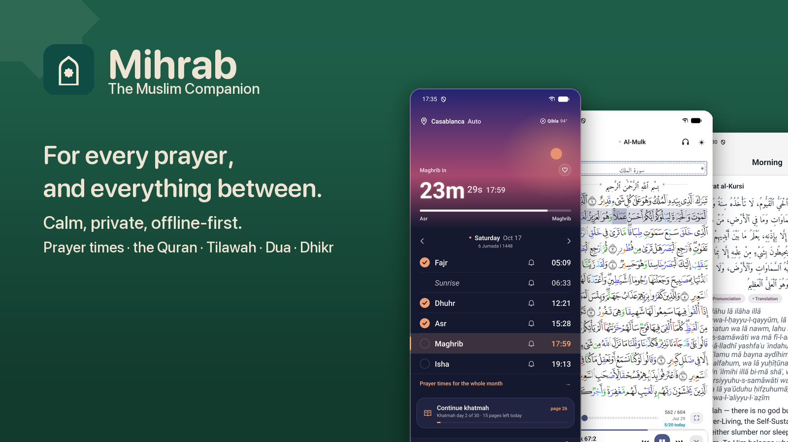

  **A Muslim's daily companion — for every prayer, and everything between.**

  Prayer times, the adhan and a qibla compass; the Madinah muṣḥaf in four riwāyāt and the IndoPak print, with recitation, tajweed colours on Ḥafṣ and Warsh, a word reader and tafsir; Tilāwah for listening surah into surah with the screen off; duas, tasbih, and a fasting and prayer journal; home-screen widgets on three platforms; a Minimal mode that leaves the sky and the countdown alone on the page; and sync between your own devices with no account and no server. No ads, no analytics, no tracking — and every line of it open source.

  **[mihrab website →](https://mihrab.elghamri.se/)**

  <br>

  <p><b>Apple</b></p>

  <p><a href="https://apps.apple.com/us/app/prayer-salah-times-qibla/id6762085256"></a></p>

  <p>Mac: <code>brew install --cask mihrabhq/tap/mihrab</code></p>

  <p><b>Android</b></p>

  <p>
  <a href="https://apps.obtainium.imranr.dev/redirect?r=obtainium://app/%7B%22id%22%3A%22com.prayer_times%22%2C%22url%22%3A%22https%3A%2F%2Fgithub.com%2FMihrabHQ%2FMihrab%22%2C%22author%22%3A%22Hassan-PS%22%2C%22name%22%3A%22Mihrab%22%7D"></a>&nbsp;
  <a href="https://play.google.com/store/apps/details?id=com.prayer_times"></a>&nbsp;
  <a href="https://f-droid.org/packages/com.prayer_times/"></a>&nbsp;
  <a href="https://github.com/MihrabHQ/Mihrab/releases/latest"></a>
  </p>

  <p><sub>Obtainium is recommended: first to get every update, and it updates itself. Don’t have it? <a href="https://github.com/ImranR98/Obtainium">Get Obtainium</a>.</sub></p>

</div>

<!-- accuracy:start -->
<div align="center">

<a href="https://github.com/MihrabHQ/mihrab-methods"></a>

Prayer times computed with **[mihrab-methods](https://github.com/MihrabHQ/mihrab-methods)**, the authorities’ own methods checked against every time they have published.

</div>

| Matches the published timetable of | Times checked | Off the printed minute |
|---|---:|---:|
| Islamiska Förbundet (Sweden), and Diyanet’s tables for Sweden | 1,454,148 | **0** |
| Diyanet, Türkiye and worldwide | 69,999,603 | **0** |
| Morocco’s Ministry of Habous and Islamic Affairs | 75,768 | **0** |
| Algeria’s Ministry of Religious Affairs and Wakfs | 101,184 | **0** |
| Indonesia’s Kemenag | 266,772 | **0** |

<sub>Last checked 30 October 2026. Generated from mihrab-methods’ <code>certification.json</code> by <code>scripts/build-copy.js</code>. Mihrab is independent and not affiliated with any of these authorities.</sub>
<!-- accuracy:end -->

---

## Screenshots

<div align="center">

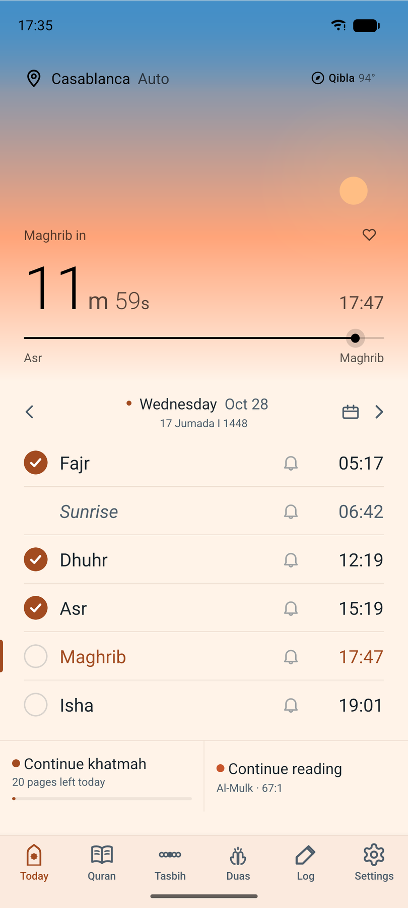&nbsp;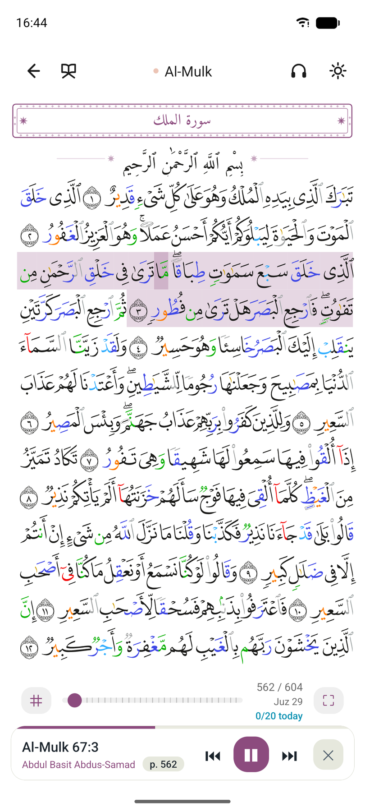&nbsp;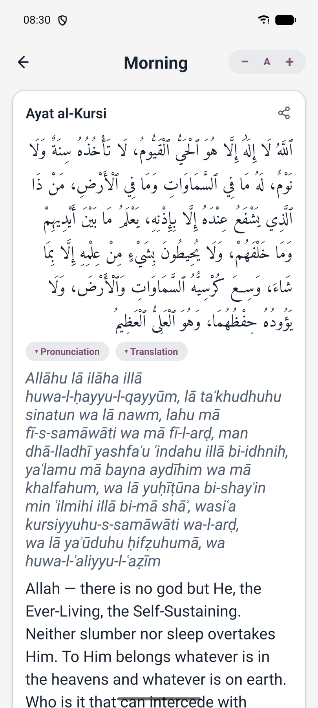

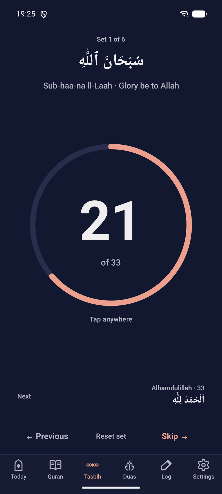&nbsp;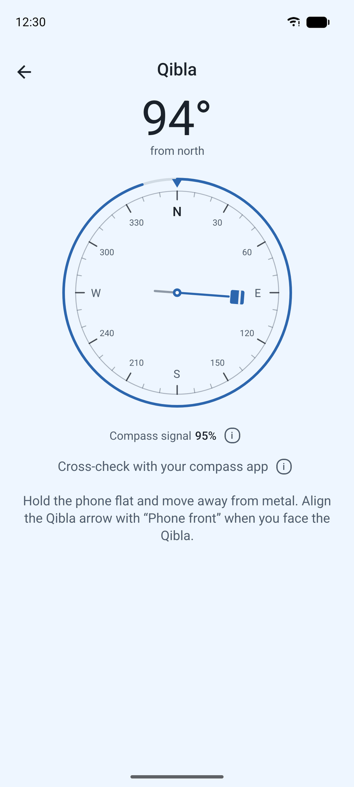&nbsp;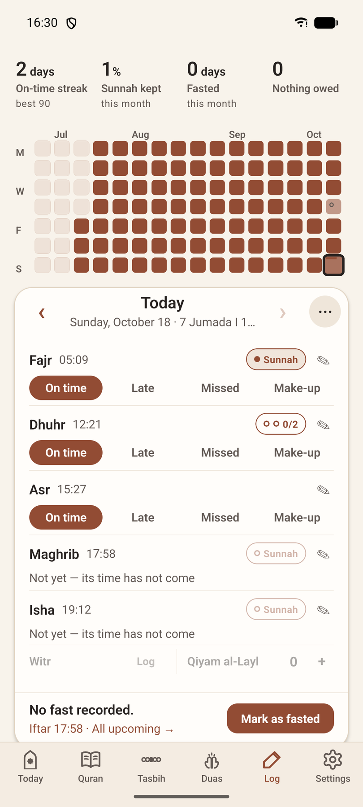

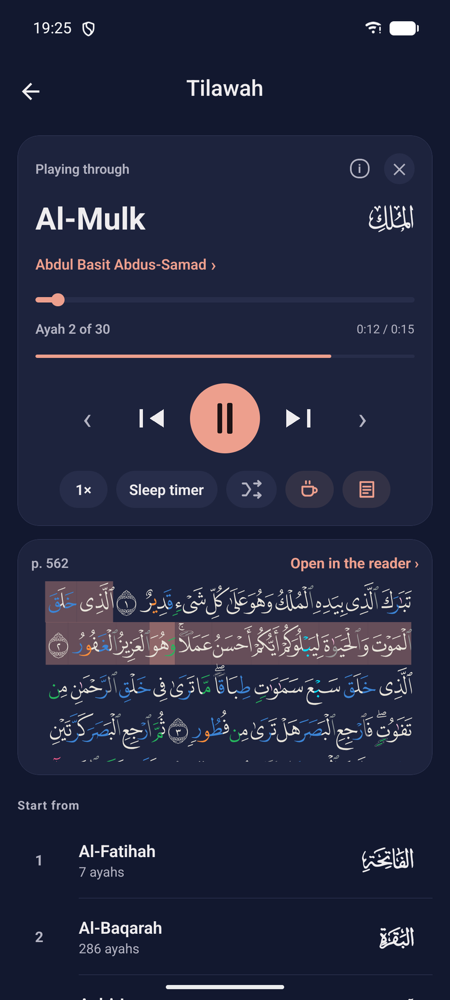&nbsp;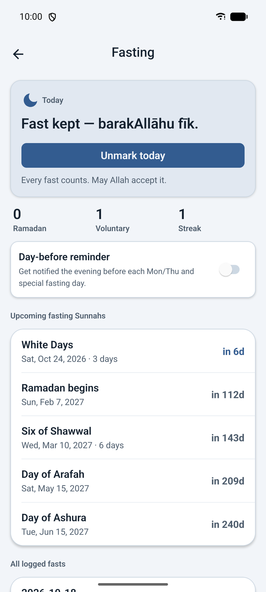&nbsp;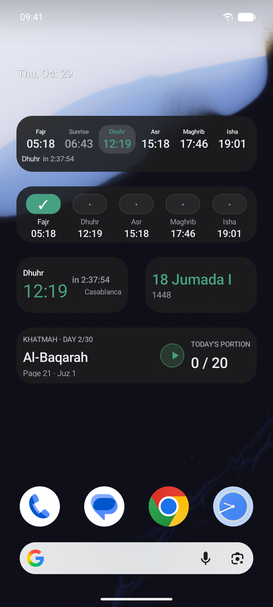

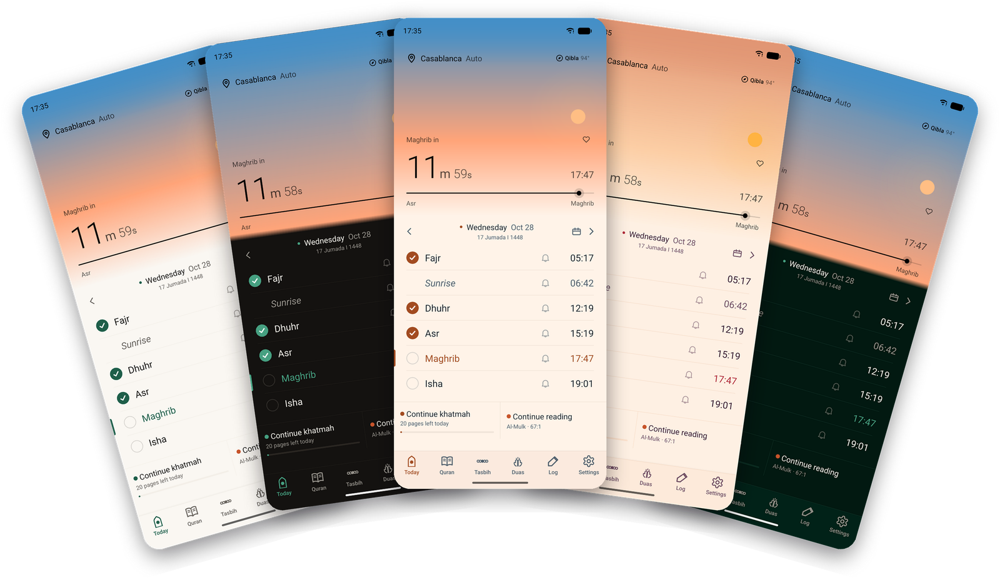
<br><sub>One app, five looks — Light, Dark, Sky (Realistic and Vibrant) and the green colour theme.</sub>

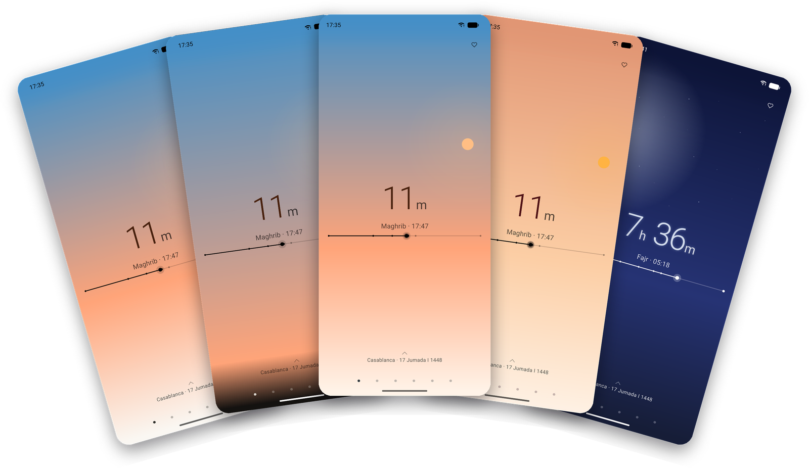
<br><sub>Minimal mode — the next prayer and nothing more. Swipe up for the day's times.</sub>

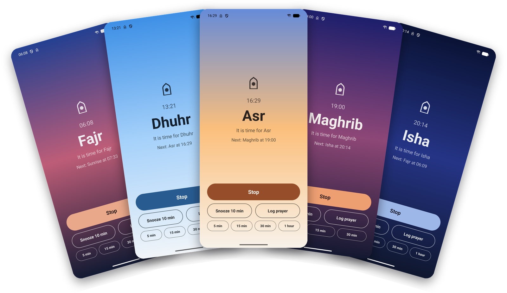
<br><sub>Full-screen prayer alerts on Android, under the Sky theme — each in its hour.</sub>

</div>

---

## Features

### Pray

- **Prayer times, online or off** — Daily times and a full month view up to a year ahead. Cached on-device so the app opens instantly without a connection; falls back to on-device calculation when the network is away.
- **The day's own sky** — Behind the countdown, one continuous scene drawn from the clock: night with the moon in its actual phase, dawn through the horizon's rose and orange, the day with the sun climbing to its height about Ẓuhr, sunset, and the afterglow darkening into night. It is true to the hour rather than to the theme — noon is bright in a dark app — and the moon's phase and the sun's light are computed from your own coordinates rather than approximated. Every look has it — light, dark and system as well as Sky: the horizon's glow low in the sky, the fuller stars, the countdown's halo by night, and a sky that runs into the page rather than stopping at an edge.
- **Minimal** — Settings → Appearance → Minimal (or the first-run walkthrough) takes the chrome off Today: the sky, the countdown with the prayer's name and time under it, the rail, and one line saying where and which day. A drag up brings the day's times as a sheet — a check beside each salāh, the month's calendar, the Qibla and the place — that swipes from day to day as the full page's table does. The tabs become a row of dots, and the pages turn side by side as the muṣḥaf's do. On the phone and the iPad; the full page is a switch away.
- **Adhan & reminders** — 17 built-in adhan recordings (or import your own), a pre-prayer reminder window, and exact-alarm scheduling so the adhan lands on time even under aggressive battery managers. Each prayer decides how it speaks — adhan, a plain alert, or silent — and can be changed for just the next one from Today. On Android the adhan can play as an alarm, so it is heard with the phone on silent or vibrate.
- **Snooze that knows when the prayer ends** — Snooze from the notification or the full-screen alert: 10 minutes at a tap, or 5, 15, 30 or 60. Only lengths that still leave at least 15 minutes of the prayer are offered; when none does, the button becomes "Last chance to pray …", which comes back 15 or 5 minutes before the time runs out. Fajr ends at sunrise, Isha at the next Fajr.
- **A full-screen prayer alert** — Like an alarm clock, over the lock screen: the prayer, the next one under it, Stop, Snooze and Log prayer. On Android it is its own screen, painted in that prayer's sky; on iOS 26 and later it rings as an AlarmKit alarm, through silent mode and Focus. Offered in the first-run walkthrough, off until you say so.
- **Times that match your authority's timetable** — **Sweden** (Islamiska Förbundet), **Diyanet** (Türkiye and its places worldwide), **Morocco** (the Ministry of Habous and Islamic Affairs), **Algeria** (the Ministry of Religious Affairs and Wakfs) and **Indonesia** (Kemenag) are calculated on the phone with the authority's own method from [mihrab-methods](https://github.com/MihrabHQ/mihrab-methods), on the printed minute for every time they were checked against (the table at the top). **Singapore** (MUIS), **Malaysia** (JAKIM) and **Türkiye Takvimi** (namazvakti.com) are their published tables, taken minute for minute from this repo for your nearest listed city, with the authority's own service as a backup. Everywhere else: AlAdhan, or calculation on the device (Adhan JS). "Automatic" picks the right one for where you are, and a source pinned for one country quietly gives way to AlAdhan outside it ([where each comes from](docs/prayer-times-sources.md)).
- **Says when it is standing in** — If the table you chose has nothing for today, the phone calculates the day with that authority's own method and says so, on the source row and under the month. Türkiye Takvimi warns when no listed city is near enough.
- **24 calculation methods, or your own angles** — The 17 AlAdhan methods plus Dubai, JAKIM, Kemenag, Tunisia, Portugal, Jordan and Sweden (the Istanbul congress method Diyanet computes Islamiska Förbundet's tables by, within a minute by the method alone and on the printed minute with its yearly correction list — [mihrab-methods](https://github.com/MihrabHQ/mihrab-methods)), each tuned to what that authority publishes and checked against it every week; hill towns are computed at their height, and Umm al-Qura's Isha moves to two hours in Ramadan as it does in Makkah. Or set the Fajr and Isha angles yourself.
- **High latitudes** — Where the summer sun never sinks far enough for Fajr and Isha, choose the rule: the angle-based share of the night (the default), the middle of the night, or a seventh of it. Polar days and nights get times rather than blanks.
- **Tuned to your mosque** — Per-prayer minute offsets, Hanafi or standard Asr, and the extra marks when you want them: sunrise, Islamic midnight, the last third of the night, and the first third after Isha.
- **Your madhhab** — Hanafi, Maliki, Shafiʿi or Hanbali: the Asr shadow and the prayer names follow it, and the walkthrough shows each answer in your own times.
- **Maliki second times** — Off by default: turn them on and each prayer gains a line saying when its preferred time (*ikhtiyārī*) closes and its late time (*ḍarūrī*) begins, computed on your device from your coordinates whichever source the times come from. From *Al-Murshid al-Muʿīn* (Ibn ʿĀshir). Fajr's and Asr's boundaries are marked approximate, and where the sun never reaches the angle nothing is shown rather than a guess.
- **Quiet for the prayer itself (Android)** — Settings → Notifications puts the phone on Do Not Disturb around each prayer you pick, from the adhan or a few minutes before, and lifts it again on its own. Jumuʿah has its own length. Alarms and whatever you already let through still come through.
- **More to remember, if you ask** — Dhikr reminders in your own words at any hour, fully offline; Surah Al-Kahf on Friday, Al-Mulk at night, the morning and evening adhkār; and a khatmah reminder carrying the day's portion. The Notifications page shows what is scheduled to fire.
- **Qibla compass** — A live dial with signal strength, a hold-still prompt when the sensors need it, and a cross-check against the sun. Falls back to the bearing when the phone has no magnetometer.
- **Saved locations** — Keep the places you check on and switch between them freely; automatic location and saved places are not alternatives, and the month sheet names the city rather than printing coordinates.
- **A month you can hand over** — The whole month as a sheet, Hijri and Gregorian side by side, exportable as an image or a PDF in any of the app's languages, with a QR back to the app.
- **Live Activity** — A pinned countdown to the next prayer: Android 16+ status-bar chip and always-on notification in three designs (countdown, timeline, or markers with a proportional bar for the next three events), iOS Lock Screen and Dynamic Island via ActivityKit. What it shows — Hijri date, location, sunrise, the lock-screen button — is yours to switch.
- **Home-screen widgets** — Prayer times in three sizes, plus Log Today (with the practice graph — a row for each prayer, a column a day — and a countdown), Hijri date, streak, tasbih and reading widgets, on iOS, Android **and** the Mac. For a while after each adhan, if you ask, the prayer-times widgets count up from it — "12:34 since Dhuhr" — before going back to the next prayer. Per-prayer accents, dynamic colour, adjustable background opacity, a text colour of your own, and on Android the prayer-times widget shows or hides the city, the countdown and the day's times at the size you set — from Settings → Widgets or from the widget itself.
- **A countdown you can point** — It runs to the second, and a tap on any prayer on Today makes it count down to that one instead.
- **Opens where you left it** — The last Today screen is the first frame of a launch, and the countdown, the sky and the day's progress sweep up to now (or, with the launch animation off, open straight on now). Pull down on Today to refresh the times; when the clocks change where you are they refresh on their own.

### Read and listen

- **Interactive Madinah mushaf** — All 604 pages, drawn as *text* from the official KFGQPC page fonts rather than as page images: sharp at any zoom, instant to rotate, and a fraction of the memory. Reading starts the moment the download does — pages arrive as their fonts do (~300 KB each) with a slim line saying how the rest is going. Paper, sepia or night; a page rail and a go-to-page jump; fullscreen from the margins.
- **A facing-page spread on iPad and Mac** — the pair of pages is the thing that turns, with the keyboard and a surah sidebar.
- **Tajweed colours** — Optional: the King Fahd Complex's own colour-coded page fonts, each letter painted for the rule it falls under. Tap an ayah to see its rules word by word and hear each word read; a guide explains every colour. The Warsh muṣḥaf has its own: the rules Warsh shares with Ḥafṣ in the same inks, and Warsh's own — naql, tashīl, taqlīl, the light rāʾ, the heavy lām, madd al-badal — each with its own.
- **The word reader** — Optional: hold a finger on a word in the muṣḥaf and, when you lift it, that one word is read out. Slide to another word before lifting to pick it instead; a tap still opens the ayah.
- **Read your way** — Volume buttons turn the pages (opt-in on Android), a reading lock — its own switch on every platform, with a lock button on the page when you want one — keeps the page from turning under your hand while a tap on a word still opens its āyah (hold the lock to unlock; or freeze the words too, for a pocket or a child), the screen stays awake while you read, the translation and tafsir take the size you set with `A− A+`, and bookmarks come in colours you choose.
- **Four riwāyāt** — Ḥafṣ from the KFGQPC page fonts, and Warsh, Qālūn and Shuʿbah as bundled-typeface muṣḥafs downloaded on request from Quranpedia; Warsh can be heard as well as read. Your place carries across a switch: the ayah is the coordinate, not the page number.
- **The IndoPak muṣḥaf** — A second way to read Ḥafṣ: the 15-line IndoPak print, 610 pages line for line as the Taj Company sets it, in the Indo-Pakistani script with its own stop signs and rukūʿ marks. About 2.2 MB, checked against the app's Ḥafṣ text at every one of the 6,236 ayahs before a word is drawn; recitation, translation, tafsir, bookmarks and the khatmah carry over by ayah.
- **Everything in one panel** — A tap on a word opens its ayah: translation, real **tafsir** (Ibn Kathir, Maarif-ul-Quran, al-Muyassar and more) and the Arabic meanings of the harder words — both downloadable for offline reading — the tajweed rules in it, coloured bookmarks, star, share as text or a rendered image card, the khatmah position, and the full recitation controls. A tafsir and a dua can be shared as text too.
- **59 reciters** — Al-Husary, Alafasy, Abdul Basit, Al-Minshawi, As-Sudais, Ash-Shatri, Ahmed Al-Ajmi, Yasser Ad-Dossari, Maher Al-Muaiqly, Saad Al-Ghamdi, plus mujawwad readings from Abdul Basit, Al-Minshawi and Al-Husary, streamed per-ayah or downloaded per-surah for offline listening; and 15 whole-surah recitations from mp3quran.net, among them Warsh, Qālūn and Shuʿbah readings, cut ayah by ayah with every cut checked on both sides. Every voice can be heard before it is chosen, and on a Warsh, Qālūn or Shuʿbah page the voices of that reading are a tap away. **Word-level highlight on the page itself** for nine of them — and in landscape the column follows the reciter down the page; prefetching keeps long sessions gapless.
- **Tilāwah — listening, as its own page** — The reader plays the passage in front of you and stops where that surah does. Tilāwah is the other act: pick a reciter, start anywhere, and it runs surah into surah with the screen off, from the lock screen, without the app open or even alive. Scrub by ayah or by whole surah, shuffle, set a speed or a sleep timer (minutes, or the end of the surah), and follow along on a live muṣḥaf page with the recited word lit. Its downloads share the reader's own folder, so a reciter fetched for a flight makes play-from-here work offline in the same act. While anything is playing a **mini-player** sits under the title bar on every screen: what it is, a progress bar for the surah, pause, and a way back to Tilāwah. Tilāwah keeps **its own place**, apart from where you are reading; come back after a while and it offers to carry on, to shuffle, or **what the sunnah recommends at that hour** — Al-Kahf from Thursday's maghrib to Friday's, As-Sajdah and Al-Insān on Friday morning, Al-Mulk, the last two āyāt of Al-Baqarah and the Muʿawwidhāt at night. On iPhone it plays as long-form spoken audio, with the lock screen's controls, and pauses when the headphones come out.
- **Memorization (hifz) tools** — Repeat each ayah ×N, repeat a range ×M, pause-between-repeats for recite-back, and hide-and-reveal masking of Arabic or translation.
- **Khatmah plans** — 30/60/90-day plans, your own length from the page you are on, or a finishing date with each day's portion worked out from what is left with automatic page tracking, a continue button, pin-your-exact-ayah positioning, a done button for the day, flexible resets, and an optional daily reminder with today's portion.
- **14 translation editions** — Sahih International, Pickthall, Bernström, Hamidullah, Diyanet, Cortés, Isa García, Bubenheim, Ma Jian, Kuliev, Indonesian Ministry, Mujibur Rahman, Jalandhry, Suhel Farooq Khan — with diacritic-insensitive Arabic + translation search, and a verse-by-verse reading view that lights the recited word too.
- **Ayah of the day** — On the Quran page, and optionally as a daily notification at a time you choose, with its translation.
- **Manage downloads** — Exactly what is on disk — muṣḥaf pages, riwāyāt, tafsir, recitation audio — with sizes, and a way to remove any of it.

### Remember

- **Dua library** — 100+ duas across 19 categories (morning, evening, after prayer, food, sleep, travel, distress, gratitude, protection, and more) with Arabic, transliteration, translation, and Hisn al-Muslim sources.
- **Tasbih counter** — Tap-to-count for the post-prayer dhikr plus open-ended Astaghfirullah and Salah on the Prophet ﷺ. Tabular numerals so digits don't shimmer on tick.
- **Fasting log** — Tracks Ramadan + voluntary Sunnah fasts (Mondays, Thursdays, Ayyam al-Bidh, Arafah, Ashura, Six of Shawwal) with day-before reminders. Encrypted on-device.
- **Log a prayer from Today** — A check beside each of the five: one tap inside the prayer's window records it on time, and once that window has closed the check asks whether it was prayed on time or made up. The table swipes a week back as well as a week ahead, so a prayer missed on the day is logged on the day it happened.
- **Prayer journal** — Log each prayer as on-time / late / missed / qadha with private notes, a practice graph — a row for each prayer and a column a day — streaks and what is owed. Optional "Log prayer" action right on the prayer notification, an end-of-day nudge, and tools to backfill or fill whole months at once. Optionally, a prayer logged from a notification, the alarm screen or a widget after half its time has gone is recorded as late. And the log can be cleared for a day, a month, a year or all of it, without touching fasts, sunnah prayers or dhikr.
- **Sunnah prayers** — The rawātib beside each fard prayer, Witr and the night prayer, logged on the same day and drawn in their own gold on the practice graph.
- **Hijri calendar** — Throughout, with Ramadan, Eid and Jumuʿah treatments and a Ramadan countdown on Home. The standard calendar, or Indonesia's (Government & NU, or Muhammadiyah), with a day adjustment that moves only the Hijri date — and, if you ask, the day can begin at maghrib, so an evening's reading belongs to the night that has begun. Where an authority announces the month differently from the prediction (Indonesia's sidang isbat), the correction is published here and reaches phones within hours.

### Yours

- **Sync between your own devices** — Pair by scanning a QR code (or copying it), and your journal, streaks, fasts, notes and settings stay in step. No account, no server of ours: the devices write **sealed** files into a folder you already keep in sync — Syncthing, Nextcloud, whatever you use — and each device holds a key that never leaves it, so what passes through that folder is unreadable to anything but the devices you paired. Choose how often it runs: on open, every 15 minutes, hourly, daily, or never.
- **Backup and restore** — Export everything as a file you keep, and import it back, on any platform.
- **Your data survives reinstalls** — Settings, journal, bookmarks and khatmah ride Android Auto Backup and device-to-device transfer; large re-downloadable content stays out of your backup quota.
- **Privacy by design** — No ads, no analytics, no tracking, no account, and nothing sent to the developer. Location settings and sensitive records are encrypted on the device. Coordinates go only where an answer needs them — to AlAdhan where it is the source, and, rounded to about a kilometre, to OpenStreetMap to name your town — as the [privacy policy](PRIVACY_POLICY.md) lists in full.

### The app itself

- **Yours to look at** — Light, dark or system, pure-black for OLED, six colour themes (green, teal, blue, amber, rose, violet) or your own hex, and the platform's own palette when you want it: **Material You** on Android, **Liquid Glass** on iOS. Or **Sky**, the look a new install starts in, which paints the whole app from the sky over the countdown and follows the sun — its height by day and its depth below the horizon by night, so a low winter sun keeps its gold and a moonlit night is lighter — in two colourings: **Realistic** (the default), the sky as it looks over a nearly neutral page, and **Vibrant**, bold colours for each hour. Each is shown by its six skies in the walkthrough and under Appearance, and the full-screen alert and the widgets follow the choice.
- **Real Arabic typography** — Amiri Quran for ayah text with correct stacked diacritics, Amiri Naskh for duas, on both platforms.
- **13 languages** — English, Arabic, Swedish, Bengali, Urdu, Hindi, French, Spanish, German, Turkish, Indonesian, Russian, and Chinese — every screen, every notification, every dua title, and the widgets too. Arabic and Urdu are fully RTL. The app starts in your phone's language and can be switched in Settings.
- **A Mac app, not a phone app in a window** — The Catalyst build has the spread reader, keyboard paging, the surah sidebar and its own widgets in Notification Centre.
- **It tells you what it is doing** — A data-statistics panel names the source in use, when each dataset was last rebuilt, how far ahead it reaches, and when the next check is due.
- **It tells you what changed** — The first launch after an update opens What's new, with every release before it underneath; Settings → About keeps the whole list, and the data panel can be folded away.
- **A 12-hour clock**, or 24, or whatever your phone uses.
- **Open source** — AGPL-3.0-or-later. Anyone who ships a fork, or runs it as a service, must publish their source too. The F-Droid flavor ships without Google Play Services. There are no in-app purchases in any build.

---

## Install

| Platform | Link |
|---|---|
| **iPhone & iPad** | [App Store](https://apps.apple.com/us/app/prayer-salah-times-qibla/id6762085256) |
| **macOS** | `brew install --cask mihrabhq/tap/mihrab` — native Mac Catalyst build from [GitHub Releases](https://github.com/MihrabHQ/Mihrab/releases/latest), for Intel and Apple silicon Macs on macOS 12.1 (Monterey) or later; the widgets need macOS 14 |
| **Android — Obtainium (recommended)** | [Add to Obtainium](https://apps.obtainium.imranr.dev/redirect?r=obtainium://app/%7B%22id%22%3A%22com.prayer_times%22%2C%22url%22%3A%22https%3A%2F%2Fgithub.com%2FMihrabHQ%2FMihrab%22%2C%22author%22%3A%22Hassan-PS%22%2C%22name%22%3A%22Mihrab%22%7D) — first to get every update, and it updates itself. Needs [Obtainium](https://github.com/ImranR98/Obtainium) installed |
| **Android — Google Play** | [Google Play](https://play.google.com/store/apps/details?id=com.prayer_times) |
| **Android — F-Droid** | [f-droid.org/packages/com.prayer_times](https://f-droid.org/packages/com.prayer_times/) |
| **Android — APK** | [GitHub Releases](https://github.com/MihrabHQ/Mihrab/releases/latest) → `Mihrab-vX.Y.Z.apk` (ARM phones, 32- and 64-bit) |

---

## Build

```sh
npm install
npm start
```

### Android

```sh
# F-Droid APK (no Google Play Services)
npm run android:assembleFdroidRelease

# Google Play AAB
npm run android:bundlePlayRelease
```

Outputs:
- F-Droid APK: `android/app/build/outputs/apk/fdroid/release/app-fdroid-release.apk`
- GitHub/Obtainium APK: `android/app/build/outputs/apk/github/release/app-github-release.apk` (`npm run android:assembleGithubRelease`)
- Play AAB: `android/app/build/outputs/bundle/playRelease/app-play-release.aab`

### iOS

```sh
npm run ios
```

Archive and upload via Xcode Organizer for App Store / TestFlight.

### Tests

```sh
npx jest        # 6,500+ unit tests
npm run e2e     # Maestro end-to-end flows (needs a running emulator/simulator)
```

---

## Supporting the project

**Mihrab does not take money.** There is no donation link, no sponsorship, no
in-app purchase and no tip jar — the billing library was removed from the
project outright, and no build pulls one back in. Several people have kindly
offered; the answer is the same to everyone. It is not that kind of project,
and it is not going to become one.

Four kinds of support are welcome, and they are worth more:

- **Dua** — for me and my parents, and for everyone whose work this is built on.
- **Constructive feedback** — a prayer time that disagrees with your masjid, a
  translation that reads wrong, a screen that fights you. Say what you saw and
  what you expected in [an issue](https://github.com/MihrabHQ/Mihrab/issues);
  that is how the bugs get found.
- **Pass it on** — rate Mihrab where you got it, and tell family and friends.
  The app's own month sheet (Settings → About → Help Mihrab) is an easy thing to
  send. A project with no marketing reaches the next person this way.
- **Code** — pull requests, translations, and reproducible bug reports. The
  build instructions are above and the whole thing is AGPL.

If you were going to send something, send it to your local masjid or to relief
work you trust instead. Nothing needs to come here.

---

## Content sources & thanks

Religious content is sourced and attributed (also listed in-app under Settings → About):

- Quran Uthmani text — [Tanzil.net](https://tanzil.net/) (CC BY 3.0)
- Madinah mushaf — KFGQPC QPC v2 page fonts, mirrored at [nuqayah/qpc-fonts](https://github.com/nuqayah/qpc-fonts) ([KFGQPC terms](https://dm.qurancomplex.gov.sa/copyright-2/)); page layout built from the [quran.com API](https://api-docs.quran.com/)
- Tajweed colours — KFGQPC QPC V4 Tajweed page fonts, from the [Quranic Universal Library](https://qul.tarteel.ai/resources/font) ([KFGQPC terms](https://dm.qurancomplex.gov.sa/copyright-2/)), downloaded on request; the rules of each word from the [quran.com API](https://api-docs.quran.com/) (`text_uthmani_tajweed`)
- Ayah and word positions — [quran.com / Quran for Android](https://github.com/quran/quran_android)
- Recitation audio — [EveryAyah.com](https://everyayah.com/); word timings from [cpfair/quran-align](https://github.com/cpfair/quran-align) (CC BY 4.0)
- Tafsir texts — [spa5k/tafsir_api](https://github.com/spa5k/tafsir_api) mirror of the Quran.com tafsir corpus
- Translations — [alquran.cloud](https://alquran.cloud/) (Tanzil-derived, CC BY 3.0)
- Duas — [Hisn al-Muslim](https://github.com/rn0x/hisn_almuslim_json) (MIT)
- Arabic fonts — [Amiri & Amiri Quran](https://github.com/aliftype/amiri) (SIL OFL 1.1)

---

## License

[AGPL-3.0-or-later](LICENSE) — use it, study it, change it, share it. If you
distribute a modified version, or run one as a network service, you must
publish your source under the same terms.

**Why AGPL** (#116). It keeps Mihrab and every version of it free for
everyone: no one can take the work and close it off, which is what a
waqf-style licence sets out to protect. Mihrab has no clause limiting who may
use it or for what: a restriction like that would make it non-free, so
F-Droid and most Linux distributions could no longer carry it, and the
licences of what it bundles (SIL OFL for the fonts, MPL-2.0 for the
prayer-time methods, MIT for other parts) allow no added restrictions, which
the AGPL itself forbids too.

The **name "Mihrab" and the app icon are not covered by the licence** —
no free-software licence grants trademark rights. Builds of this project
carry the name freely, whoever distributes them — build and packaging
patches, security backports and translations included, so F-Droid's recipe
is fine. A fork that changes what the app *does* needs its own name and
icon. See [TRADEMARK.md](TRADEMARK.md).
